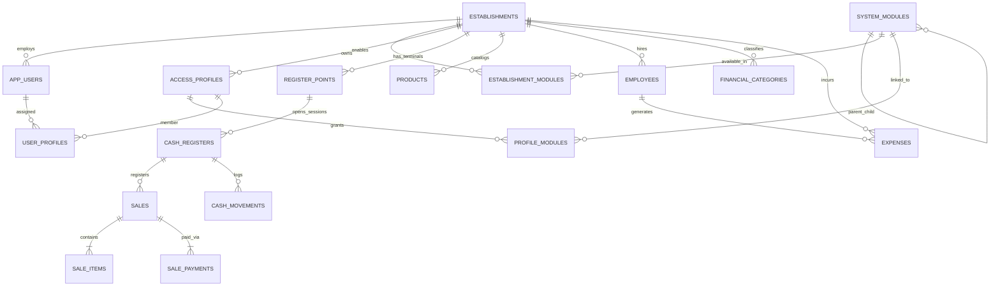

# Palheta Soft ERP — Documento de Design (Ciclo 1: Arquitetura Base, Migrations e Frente 1)

**Data:** 2026-11-17  
**Repositório:** `https://github.com/palhetati/palhetasoft`  
**Status:** Aprovado pelo usuário (com ajustes de Ajuda Contextual e `parametros_web` incorporados)  

---

## 1. Intenção e Propósito (O "Porquê")

O **Palheta Soft** é um ERP SaaS multi-empresa (B2B) projetado para gerenciar estabelecimentos comerciais de ponta a ponta, tendo como primeiro cliente real um **balneário** (que reúne bar, restaurante, controle de portaria, piscinas naturais/artificiais e equipe mista de colaboradores CLT e diaristas/não-CLT).

O produto é dividido estrategicamente em duas frentes:
1. **Frente 1 — ERP Padrão (Escopo deste Ciclo 1):** A espinha dorsal de arquitetura, permissões dinâmicas, componentes reutilizáveis e gestão financeira/operacional que qualquer empresa precisa (Dashboard com Visão Real vs. Prevista + Reserva Contábil, Múltiplos Caixas por Ponto, PDV preparado para Gateways e Pagamento Dividido, Despesas Fixas e Variáveis, Produtos/Estoque simples e Gestão de Funcionários CLT com demonstrativo contábil completo + Não-CLT/Diaristas).
2. **Frente 2 — Especificidades Verticais do Cliente (Escopo do Ciclo 2 — Balneário):** Módulos especializados habilitados apenas para clientes daquele segmento (Portaria/Ingressos, Carteira de Créditos Pré-pagos / Consumo Cashless dentro do PDV, Mesas/Comandas e Operação de Piscinas).

---

## 2. Objetivos, Não-Objetivos e Anti-Objetivos

### Objetivos (Goals) do Ciclo 1
- **Migrations-First em Docker Local:** Entregar toda a estrutura do banco no padrão Supabase CLI (`supabase/config.toml`, `supabase/migrations/`, `supabase/seed.sql`), pronta para rodar localmente via Docker no esquema `public` com isolamento multi-empresa (`establishment_id`) e **Row Level Security (RLS)**.
- **Super-Admin Irrestrito, Onboarding Fechado e Motor Dinâmico de Módulos/Perfis:**
  - Cadastro de novas empresas restrito ao **Super-Admin** (dono da Palheta Soft).
  - **Super-Admin com Acesso Total e Seletor de Empresa ("Modo Suporte"):** O Super-Admin pode acessar qualquer módulo do sistema e alternar entre qualquer empresa cadastrada para configurar, dar suporte ou operar o ERP usando seu próprio login.
  - Módulos armazenados no banco em estrutura hierárquica (`parent_id`), configuráveis com rota, ícone e ordem.
  - Perfis de acesso atribuíveis a módulos-pai (herdando todos os filhos) ou módulos-filhos individuais.
  - Suporte a múltiplos perfis por usuário (união de permissões).
  - **Sidebar carregada no Login:** A árvore de navegação permitida é calculada no momento do login e persistida na sessão; mudanças de perfil/menu refletem apenas ao deslogar e logar novamente (exceto quando o Super-Admin troca de empresa ativa no seletor de suporte, o que recalcula o contexto da empresa selecionada).
- **Arquitetura de Componentes Base Reutilizáveis (`src/components/ui/`):**
  - Criação centralizada e padronizada de `Button`, `Card`, `Input`, `Select`, `Modal`, `Alert`, `Accordion`, `Badge`, `HelpHint` (ícone elegante `?` de ajuda contextual) e `ResponsiveDataTable` seguindo 100% o `DESIGN.md`.
  - Regra estrita de engenharia: nenhum módulo cria botões, cards ou inputs avulsos; todo componente nasce pensado para reuso global, sendo criado conforme a necessidade das telas.
- **Ajuda Contextual sem Travessões em Todos os Módulos:**
  - Cada módulo do sistema exibirá no cabeçalho um ícone bonito de ajuda (`?`), carregando a explicação diretamente da própria tabela `system_modules` (`help_title`, `help_text`). Alguns cards importantes (como Líquido Real vs. Previsto, Reserva Contábil CLT e Conferência Física de Gaveta) também terão ícone de ajuda pontual, sem exagerar em todos os cards.
  - **Regra de Redação (Copywriting):** É proibido utilizar travessões (`—` ou `–`) nos textos de ajuda e textos de interface voltados ao usuário. A escrita deve ser natural, clara e didática, usando apenas pontuação simples (vírgulas, dois-pontos e pontos finais).
- **Parametrização Global (`parametros_web`):**
  - Nenhuma alíquota ou regra tributária da CLT ficará fixa no código. A tabela `parametros_web` (`chave_parametro`, `valor_parametro` do tipo `TEXT` amplo suportando JSON estruturado ou valores extensos) armazenará todas as alíquotas, tabelas progressivas de INSS/IRRF, FGTS, frações de 13º/Férias, teto de Vale-Transporte e vencimentos padrão, permitindo manutenção sem alterar código.
- **100% Responsivo (Mobile, Tablet e Desktop):** Operação fluida no celular (`<= 600px`), tablet (`768–840px`) e desktop (`1080px+`), com alvos de toque mínimos de `44x44px`.
- **Frente 1 Operacional Completa:**
  - **Dashboard Financeiro (Visão Dupla + Provisões):** Caixa Realizado (entradas líquidas de taxas menos despesas efetivamente pagas), Visão Prevista (contas pendentes a pagar no mês) e Indicador de Reserva Contábil (provisões de 13º/Férias acumuladas).
  - **Múltiplos Caixas Simultâneos por Ponto:** Suporte a vários caixas abertos ao mesmo tempo identificados por ponto/nome (ex.: `"Caixa Bar"`, `"Caixa Restaurante"`, `"Caixa Portaria"`), permitindo que operadores autorizados vendam no caixa aberto daquele ponto.
  - **PDV e Pagamentos Preparados para Gateway/Maquininha:** Venda direta com baixa opcional de estoque, pagamento dividido (`split payment`, ex.: parte PIX + parte Dinheiro) e arquitetura de banco/código já pronta para plugar Gateways de pagamento e terminais de maquininha (SmartPOS/TEF) no futuro.
  - **Despesas Fixas e Variáveis:** Gestão completa de contas a pagar e pagas, com baixa opcional direto na gaveta de um Caixa aberto.
  - **Funcionários CLT (com Simulador/Guia Contábil e Títulos Separados) e Não-CLT:** Ao cadastrar/gerir um CLT, o sistema calcula todos os custos legais (INSS, FGTS 8%, Férias + 1/3, 13º Salário, benefícios) e gera os títulos mensais separados por obrigação/vencimento (Salário, FGTS, Guia INSS/Benefícios) + lançamentos marcados como **Reserva Contábil (`is_provision = true`)** para 13º e Férias (evitando dupla contagem no Caixa Real); para Não-CLT (diaristas/extras), permite lançar diárias gerando Despesa Variável.

### Não-Objetivos do Ciclo 1 (Non-Goals)
- Integração ativa com APIs externas de Gateways de Pagamento ou hardware de maquininha neste ciclo (apenas a arquitetura e tabelas ficam 100% prontas para recebê-los).
- Implementação das telas da Frente 2 (Portaria, Piscinas, Mesas/Comandas e Recarga/Consumo de Créditos do Balneário — documentadas na Seção 8 para o Ciclo 2).
- Emissão de nota fiscal eletrônica (NFC-e/NF-e) junto à SEFAZ.
- Tela pública de auto-cadastro ("Crie sua conta grátis").

### Anti-Objetivos (Anti-Goals)
- **Desviar do `DESIGN.md`:** Usar cores estruturais fora do `#0075de`, aplicar cores de stickers em CTAs, usar fundo branco puro em páginas inteiras (em vez do `#f6f5f4`) ou sombras pesadas.
- **Componentes Duplicados:** Criar `<button className="...">` ou `<input className="...">` customizados espalhados pelas páginas em vez de consumir `src/components/ui`.
- **Consultar Permissões de Menu a Cada Clique:** Recarregar a árvore da sidebar do banco em cada navegação de rota comum.

---

## 3. Abordagens Arquiteturais Consideradas

1. **Abordagem 1 (Escolhida) — Next.js Modular + Migrations Supabase Puras com RPCs Transacionais no Postgres + RLS Nativo:**
   - *Como funciona:* Código organizado por módulos de domínio no Next.js App Router consumindo um Design System único (`src/components/ui`), enquanto operações críticas (venda com pagamento dividido + estoque + caixa, estorno de venda, geração de folha CLT sem duplicidade e resolução recursiva da árvore de módulos no login) executam dentro de funções transacionais no PostgreSQL com RLS ativo em todas as tabelas.
   - *Trade-off:* Exige migrations SQL bem estruturadas logo na largada, mas garante atomicidade total e máxima performance no plano gratuito do Supabase.
2. **Abordagem 2 (Descartada) — Lógica Transacional em TypeScript (Server Actions sequenciais) com Tabelas Simples:** Descartada por falta de atomicidade ACID entre múltiplas requisições HTTP.
3. **Abordagem 3 (Descartada) — ORM Externo (Prisma/Drizzle) fora do fluxo Supabase CLI:** Descartada por perder sinergia direta com RLS `auth.uid()` e ferramentas nativas do Supabase Docker.
4. **Abordagem 4 (Descartada) — Backend Node/NestJS Separado + Frontend Next.js:** Descartada por dobrar infraestrutura sem ganho prático para o Ciclo 1.

---

## 4. Modelagem do Banco de Dados (Migrations Ciclo 1)

Todas as tabelas residem no schema `public` com RLS habilitado. Uma função auxiliar `public.can_access_establishment(target_establishment_id uuid)` valida no banco se o usuário autenticado é `is_super_admin = true` (acesso total a qualquer empresa) ou se pertence àquela empresa ativa (`app_users.establishment_id = target_establishment_id`).

### 4.1. Diagrama de Arquitetura de Dados

### 4.2. Tabelas de Plataforma, Empresas, Módulos e Perfis (`Migration 001`)

1. **`establishments` (Empresas/Clientes):**
   - `id` (`uuid`, PK), `name` (`text`), `slug` (`text`, unique), `document_cnpj` (`text`), `business_vertical` (`text`: `'general' | 'balneario'`), `tax_regime` (`text`: `'simples_nacional' | 'lucro_presumido' | 'lucro_real' | 'mei'`), `allow_negative_stock` (`boolean`, default `true`), `is_active` (`boolean`), `created_at` (`timestamptz`).
2. **`app_users` (Vínculo com `auth.users`):**
   - `id` (`uuid`, PK, FK `auth.users.id`), `establishment_id` (`uuid`, FK `establishments.id`, nullable para `is_super_admin = true`), `full_name` (`text`), `email` (`text`), `is_super_admin` (`boolean`, default `false`), `is_active` (`boolean`, default `true`), `created_at` (`timestamptz`).
3. **`system_modules` (Árvore de Menus, Módulos e Ajuda Contextual):**
   - `id` (`uuid`, PK), `parent_id` (`uuid`, FK `system_modules.id`, nullable), `code` (`text`, unique), `label` (`text`), `route_path` (`text`, nullable para nós agrupadores), `icon_name` (`text`), `help_title` (`text` — título amigável sem travessões), `help_text` (`text` — explicação clara para o usuário sobre o que fazer naquela tela, sem travessões), `module_scope` (`text`: `'super_admin' | 'core_erp' | 'balneario'`), `sort_order` (`integer`), `is_active` (`boolean`).
4. **`parametros_web` (Tabela Global de Parâmetros Dinâmicos):**
   - `id` (`uuid`, PK), `establishment_id` (`uuid`, FK `establishments.id`, nullable: `NULL` define o parâmetro global padrão do sistema e quando preenchido permite sobrescrita específica de uma empresa), `chave_parametro` (`text`, ex.: `'clt_tributos_vigentes'`, `'financeiro_config_padrao'`), `valor_parametro` (`text` amplo sem limite curto, armazenando JSON serializado/BSON textual ou texto longo), `descricao` (`text`), `updated_at` (`timestamptz`), com constraint única em `COALESCE(establishment_id, '00000000-0000-0000-0000-000000000000') + chave_parametro`.
5. **`establishment_modules` (Módulos habilitados na empresa):**
   - `establishment_id` (`uuid`, FK), `module_id` (`uuid`, FK), PK composta.
5. **`access_profiles` (Perfis de Acesso):**
   - `id` (`uuid`, PK), `establishment_id` (`uuid`, FK nullable para templates globais), `name` (`text`), `description` (`text`), `can_cancel_sales` (`boolean`, default `false`), `is_system` (`boolean`), `created_at` (`timestamptz`).
6. **`profile_modules` (Permissões do Perfil na Árvore):**
   - `profile_id` (`uuid`, FK), `module_id` (`uuid`, FK), PK composta.
   - **Regra da RPC `resolve_user_navigation(p_user_id uuid, p_active_establishment_id uuid)`:**
     - Se o usuário for **`is_super_admin = true`**, retorna **100% dos módulos ativos** (`super_admin` + módulos do ERP/empresa selecionada) e permissão total em todas as ações.
     - Para usuários normais: se `profile_modules` contém um **módulo-pai**, a query `WITH RECURSIVE` libera automaticamente todos os filhos ativos contratados pela empresa; se contém apenas **módulos-filhos**, traz o pai como agrupador visual e libera apenas os filhos atribuídos; múltiplos perfis em `user_profiles` são combinados via `UNION`.
7. **`user_profiles` (Vínculo N:N Usuário ↔ Perfis):**
   - `user_id` (`uuid`, FK `app_users.id`), `profile_id` (`uuid`, FK `access_profiles.id`), PK composta.

#### Fluxo de Sessão da Sidebar e Seletor do Super-Admin
- No login, o snapshot da Sidebar e permissões é gravado na sessão autenticada e renderizado pelo `AppShell` sem novas queries a cada clique. Para usuários comuns, mudanças de perfil/menu refletem ao **deslogar e logar novamente**.
- Para o **Super-Admin**, o topo da Sidebar exibe um seletor rápido **"Empresa em Operação (Modo Suporte)"** que troca o cookie `active_establishment_id`, permitindo inspecionar e operar o ERP de qualquer cliente imediatamente.

---

### 4.3. Tabelas Operacionais e Financeiras — Frente 1 (`Migration 002`)

1. **`financial_categories`:**
   - `id`, `establishment_id`, `name`, `type` (`'income' | 'expense_fixed' | 'expense_variable'`), `color_token` (tokens da paleta de stickers do `DESIGN.md`), `is_system`.
2. **`payment_method_configs`:**
   - `id`, `establishment_id`, `code` (`'cash' | 'pix' | 'debit_card' | 'credit_card' | 'customer_credit'`), `label`, `settlement_mode` (`'manual_pos' | 'gateway_api' | 'smart_pos_terminal'`), `provider_name`, `fee_percent` (`numeric(5,2)`), `fixed_fee_amount` (`numeric(12,2)`), `is_active` (`boolean`).
3. **`register_points` (Pontos / Terminais de Caixa):**
   - `id`, `establishment_id`, `name` (ex.: `"Caixa Bar"`, `"Caixa Restaurante"`, `"Caixa Central"`), `location_note`, `is_active` (`boolean`).
4. **`cash_registers` (Sessões Abertas por Ponto de Caixa):**
   - `id`, `establishment_id`, `register_point_id` (FK `register_points.id` — constraint parcial `UNIQUE (register_point_id) WHERE status = 'open'`, permitindo múltiplos pontos abertos ao mesmo tempo na empresa, mas apenas 1 sessão aberta por ponto físico), `opened_by`, `closed_by`, `status` (`'open' | 'closed'`), `opening_balance` (dinheiro físico na gaveta), `closing_cash_expected` (apurado exclusivamente sobre movimentações em espécie `'cash'`), `closing_cash_declared` (valor físico contado na gaveta), `cash_difference_amount`, `closing_summary_by_method` (`jsonb` — totais informativos de PIX e Cartões no turno), `notes`, `opened_at`, `closed_at`.
   - Qualquer operador com acesso ao `/pdv` na empresa pode registrar vendas selecionando qual caixa aberto (`cash_register_id`) está operando no momento (persistido localmente no navegador do terminal/celular para agilidade).
5. **`products` (Catálogo e Estoque Simples):**
   - `id`, `establishment_id`, `name`, `sku`, `category` (`'bar' | 'restaurante' | 'geral'`), `unit_price` (`numeric(12,2)`), `cost_price` (`numeric(12,2)`), `track_stock` (`boolean`), `stock_quantity` (`numeric(12,3)`), `min_stock_alert` (`numeric(12,3)`), `is_active` (`boolean`).
6. **`sales` (Cabeçalho da Venda):**
   - `id`, `establishment_id`, `cash_register_id`, `created_by`, `cancelled_by` (nullable), `origin_module` (`'pdv' | 'portaria' | 'comanda'`), `customer_name`, `subtotal_amount`, `discount_amount`, `gross_amount`, `total_fee_amount`, `net_amount`, `status` (`'pending_payment' | 'completed' | 'cancelled'`), `cancel_reason`, `created_at`, `cancelled_at`.
7. **`sale_items`:**
   - `id`, `establishment_id`, `sale_id`, `product_id`, `product_name_snapshot`, `quantity`, `unit_price`, `total_price`.
8. **`sale_payments` (Pagamentos Divididos + Estrutura Pronta para Gateway/Maquininha):**
   - `id`, `establishment_id`, `sale_id`, `payment_method` (`'cash' | 'pix' | 'debit_card' | 'credit_card' | 'customer_credit'`), `settlement_mode` (`'manual_pos' | 'gateway_api' | 'smart_pos_terminal'`), `provider_name`, `external_transaction_id`, `external_qr_code`, `external_payload` (`jsonb`), `gross_amount`, `fee_percent`, `fee_amount`, `net_amount`, `status` (`'pending' | 'approved' | 'declined' | 'cancelled' | 'refunded'`), `paid_at`, `created_at`.
9. **`employees` (Colaboradores CLT e Não-CLT):**
   - `id`, `establishment_id`, `full_name`, `document_cpf`, `phone`, `role_title`, `contract_type` (`'clt' | 'non_clt'`), `base_salary_monthly` (`numeric(12,2)`), `daily_rate` (`numeric(12,2)`), `transport_allowance_monthly` (`numeric(12,2)`), `meal_allowance_monthly` (`numeric(12,2)`), `other_benefits_monthly` (`numeric(12,2)`), `employer_inss_rate` (`numeric(5,2)`), `rat_fgts_extra_rate` (`numeric(5,2)`), `hire_date`, `is_active`, `notes`.
10. **`expenses` (Despesas Fixas, Variáveis e Reservas Contábeis CLT):**
    - `id`, `establishment_id`, `category_id`, `employee_id` (nullable), `cash_register_id` (nullable, quando paga em espécie direto da gaveta de um caixa aberto), `created_by`, `description`, `expense_type` (`'fixed' | 'variable'`), `is_provision` (`boolean`, default `false` — `true` para provisões mensais de 13º e Férias), `competence_month` (`text`, formato `'YYYY-MM'`, nullable), `obligation_code` (`text`, nullable — ex.: `'clt_salary'`, `'clt_fgts'`, `'clt_inss'`, `'clt_benefits'`, `'clt_provision_13th'`, `'clt_provision_vacation'`, com constraint única por `(employee_id, competence_month, obligation_code)` evitando geração duplicada no mês), `amount` (`numeric(12,2)`), `due_date` (`date`), `paid_at` (`timestamptz`), `status` (`'pending' | 'paid' | 'cancelled'`), `payment_method`, `accounting_metadata` (`jsonb`), `created_at`.
11. **`cash_movements` (Livro-Razão do Turno do Caixa):**
    - `id`, `establishment_id`, `cash_register_id`, `sale_payment_id` (nullable), `expense_id` (nullable), `created_by`, `movement_type` (`'opening' | 'sale_inflow' | 'sale_reversal_outflow' | 'supply_inflow' | 'bleed_outflow' | 'expense_outflow'`), `payment_method`, `amount`, `description`, `created_at`.

---

## 5. Regras Especiais de Domínio

### 5.1. Calculadora Contábil CLT Parametrizada (`parametros_web`) e Geração Separada de Obrigações/Provisões
Nenhuma alíquota, faixa ou dia de vencimento da CLT fica fixo no código. Tudo é lido dinamicamente da tabela `parametros_web` na chave `'clt_tributos_vigentes'` (`valor_parametro` contendo o JSON completo com faixas progressivas de INSS e IRRF, alíquota FGTS, fração de 13º, fração de Férias + terço constitucional, teto de desconto de VT, alíquotas patronais por regime tributário e dias padrão de vencimento), buscando primeiro uma eventual sobrescrita da empresa (`establishment_id`) e caindo para o registro global (`establishment_id IS NULL`).

No módulo `/funcionarios`, colaboradores `CLT` exibem o demonstrativo detalhado em tempo real alimentado por `parametros_web`:
- **Obrigações Mensais Efetivas (`is_provision = false`, `expense_type = 'fixed'`):**
  1. **Salário Líquido a Pagar ao Colaborador** (vencimento parametrizado, ex.: dia 05 do mês seguinte, descontando INSS retido na tabela progressiva de `parametros_web` e quota parametrizada de Vale-Transporte).
  2. **Guia FGTS Mensal** sobre o bruto conforme alíquota em `parametros_web` (vencimento parametrizado, ex.: dia 20).
  3. **Guia INSS / DARF Previdenciário** (soma do INSS/IRRF retido do empregado + eventual INSS Patronal/RAT conforme o regime em `parametros_web`, vencimento parametrizado).
  4. **Benefícios (VT / VA / Outros)** (vencimento parametrizado).
- **Reservas Contábeis Mensais (`is_provision = true`, `expense_type = 'fixed'`):**
  5. **Reserva Provisão 13º Salário + Encargos** calculada pelas frações de `parametros_web`.
  6. **Reserva Provisão Férias + Terço Constitucional + Encargos** calculada pelas frações de `parametros_web`.
- Ao acionar **"Gerar Obrigações CLT do Mês (`YYYY-MM`)"**, uma RPC lê `parametros_web` diretamente no banco e cria esses títulos separadamente (ignorando com segurança caso já tenham sido gerados naquela competência). No Dashboard Financeiro, os títulos `is_provision = false` compõem o **Caixa Realizado (quando pagos)** e o **Contas a Pagar do Mês (quando pendentes)**, enquanto os títulos `is_provision = true` aparecem em um indicador próprio de **"Reserva Recomendada (13º e Férias)"**.

### 5.2. Visão Financeira Dupla (Realizado vs. Previsto + Provisões)
A RPC `get_financial_dashboard(p_establishment_id, p_start_date, p_end_date)` calcula:
- **Faturamento Bruto:** Soma de `sales.gross_amount` (`status = 'completed'`).
- **Taxas de Pagamento:** Soma de `sales.total_fee_amount`.
- **Receita Líquida de Vendas:** `Faturamento Bruto - Taxas`.
- **Despesas Pagas no Período (`is_provision = false`):** Separadas em **Fixas Pagas** e **Variáveis Pagas**.
- **Líquido Realizado (Caixa Real):** `Receita Líquida de Vendas - (Fixas Pagas + Variáveis Pagas)`.
- **Despesas Pendentes no Período (`is_provision = false`, `status = 'pending'`):** Separadas em **Fixas a Pagar** e **Variáveis a Pagar**, projetando o **Líquido Previsto pós-pendências**.
- **Provisões Trabalhistas do Período (`is_provision = true`):** Exibidas separadamente como reserva recomendada e custo contábil ampliado.

### 5.3. Arquitetura do PDV Preparada para Gateways, Estoque e Estorno
- **Abstração de Gateway (`PaymentProcessor`):** No Ciclo 1 opera com `ManualPosProcessor` (`settlement_mode = 'manual_pos'`), mas `sale_payments` e o orquestrador TypeScript já possuem suporte nativo a estados assíncronos (`pending` -> `approved`), QR Code, ID de transação externa e payload JSON para futura conexão de APIs de pagamento e maquininhas SmartPOS/TEF.
- **[Decisão do Builder — Estoque no PDV]:** A flag `track_stock` fica no cadastro do produto. Se um produto controlado atingir estoque `<= 0`, o PDV mostra um badge de aviso de estoque negativo, mas permite concluir a venda (respeitando `establishments.allow_negative_stock = true`) para jamais travar a fila de atendimento do bar/restaurante.
- **[Decisão do Builder — Cancelamento/Estorno]:** Usuários com permissão `can_cancel_sales` (ou Super-Admin) podem estornar uma venda de um caixa aberto via RPC `cancel_pdv_sale`, que reverte o estoque, marca pagamentos como `refunded` e registra `sale_reversal_outflow` no livro do caixa.

---

## 6. Design System Centralizado e Responsividade (`DESIGN.md`)

### 6.1. Fidelidade Absoluta aos Tokens (`DESIGN.md`)
- **Canvas Geral:** `#f6f5f4` (`canvas-soft`)
- **Superfícies:** `#ffffff` (`surface` / `canvas`)
- **Ação Estrutural Única:** `#0075de` (`primary`) e `#005bab` (`primary-active`)
- **Destaque Noturno Pontual:** `#213183` (`secondary`) com texto `#ffffff`
- **Textos:** `#000000` (`ink`), `#31302e` (`ink-secondary`), `#615d59` (`ink-muted`), `#a39e98` (`ink-faint`)
- **Bordas:** `1px solid #e6e6e6` (`hairline`)
- **Stickers Decorativos (somente badges, dots e ícones):** `#62aef0`, `#d6b6f6`/`#391c57`, `#ff64c8`, `#dd5b00`/`#793400`, `#2a9d99`, `#1aae39`, `#523410`.
- **Tipografia:** `Inter` (`lnum`, `locl`) respeitando os pesos (`700` títulos com tracking negativo explícito, `600` títulos menores/eyebrows, `500` botões, `400` corpo).

### 6.2. Biblioteca Centralizada de Componentes (`src/components/ui/`)
Exportados por `@/components/ui` para uso obrigatório em todos os módulos:
- `Button` (`primary` pílula, `secondary` pílula, `utility` 8px, `icon-circular`)
- `Card` (`flat`, `elevated` sombra Level-1, `soft`, `featured-night`)
- `Input`, `Select`, `Textarea` (cantos `4px`, foco Level-1)
- `Badge` (pílula `eyebrow` + sticker dot opcional)
- `Modal` (`16px` desktop / Bottom Sheet mobile `<= 600px`)
- `Alert` e `Toast`
- `Accordion`
- `HelpHint` e `PageHeader` (botão circular sutil com ícone elegante de ajuda `?` que exibe um popover/modal amigável com o texto de `system_modules.help_text` no cabeçalho de toda tela e opcionalmente em cards estratégicos selecionados, sempre sem travessões)
- `ResponsiveDataTable` (tabela `ex-data-table-cell` no desktop; lista de `Card`s empilhados no mobile `<= 600px`)

---

## 7. Módulos e Telas Entregues no Ciclo 1

1. **`/login`:** Autenticação fechada + carga do snapshot da Sidebar na sessão.
2. **`/admin` (Super-Admin + Gestão de Acessos):** Empresas, Módulos Hierárquicos (pai/filho, rota, ícone, ordem), Perfis e Usuários + Seletor Global "Acessar Empresa".
3. **`/dashboard`:** Visão Geral Financeira (Caixa Real vs. Previsto + Provisões CLT, KPIs e meios de pagamento).
4. **`/pdv`:** Frente de venda rápida vinculada ao Ponto de Caixa aberto selecionado, suporte a pagamento dividido, prévia de taxas e layout mobile com carrinho em Bottom Sheet.
5. **`/caixa`:** Gestão de Pontos de Caixa (`"Caixa Bar"`, `"Caixa Restaurante"`, etc.), abertura de turno, suprimento/sangria e fechamento com conferência física da gaveta em espécie + resumo informativo de PIX/Cartões.
6. **`/despesas`:** Despesas Fixas, Variáveis e filtro de Provisões Contábeis, com baixa bancária ou direto na gaveta de um caixa aberto.
7. **`/funcionarios`:** Cadastro CLT (com calculadora contábil completa e geração automática dos títulos mensais separados) e Não-CLT/Diaristas (lançamento rápido de diária como Despesa Variável).
8. **`/produtos`:** Catálogo de itens, categorias e controle simples de estoque.

---

## 8. Evolução Planejada — Ciclo 2 (Balneário: Consumo por Créditos Pré-Pagos no PDV e Módulos Verticais)

### 8.1. Gastos dentro do PDV via Créditos do Cliente (Cashless Pré-Pago)
Para estabelecimentos que preferem que o cliente compre créditos antecipadamente (via Gateway online ou na Portaria) e vá apenas abatendo em produtos lá dentro sem passar cartão a cada cerveja ou porção:
1. **Tabelas do Ciclo 2 (`customer_wallets` e `wallet_transactions`):** Guardarão o saldo pré-pago do visitante (identificado por pulseira QR/RFID, CPF ou comanda).
2. **Integração Transparente no PDV já construído:** Na tela `/pdv`, bastará habilitar o método `'customer_credit'` (já existente em `payment_method_configs` e `sale_payments`). Ao finalizar a venda com `Crédito do Cliente`, a RPC debitará o saldo da carteira do visitante e baixará o estoque dos produtos instantaneamente, sem precisar de gateway externo a cada item consumido no bar.

### 8.2. Demais Módulos do Balneário no Ciclo 2
- **Portaria / Entrada no Estabelecimento:** Bilheteria Day-Use, controle de lotação e vínculo com pulseira/crédito.
- **Comandas / Mesas abertas:** Para operação pós-paga de restaurante.
- **Piscinas (Naturais e Artificiais):** Controle operacional de tratamento, limpeza, parâmetros de água e despesas de manutenção.

---

## 9. Resumo das Decisões Técnicas do Builder (`[Decisão do Builder]`)

1. **Stack:** Next.js (App Router + TypeScript), Tailwind CSS mapeado 1:1 para `DESIGN.md`, `@supabase/ssr`, `lucide-react` e `vitest` para testes automatizados das regras financeiras/contábeis e migrations.
2. **Conferência de Fechamento de Caixa:** A conferência cega (`closing_cash_expected` vs `closing_cash_declared`) compara exclusivamente o **dinheiro em espécie na gaveta**, enquanto PIX e Cartões são exibidos ao lado em um quadro informativo por meio de pagamento.
3. **Estorno de Venda (`cancel_pdv_sale`):** Habilitado para perfis com `can_cancel_sales = true` (Dono/Gerente/Super-Admin) enquanto o caixa da venda estiver aberto, revertendo saldo do caixa e devolvendo itens ao estoque.
4. **Estoque Insuficiente no PDV:** Exibe aviso visual quando `stock_quantity <= 0`, mas permite vender por padrão (`allow_negative_stock = true`) para não parar a operação do balcão.
5. **Seed Pronto para Docker Local (`supabase/seed.sql`):** Já entregará Super-Admin (`superadmin@palhetasoft.com`), empresa piloto *"Balneário Águas Claras"*, Dono, Operador de Caixa, Pontos de Caixa (`Caixa Bar`, `Caixa Restaurante`), Árvore completa de Módulos/Menus e catálogo inicial.
